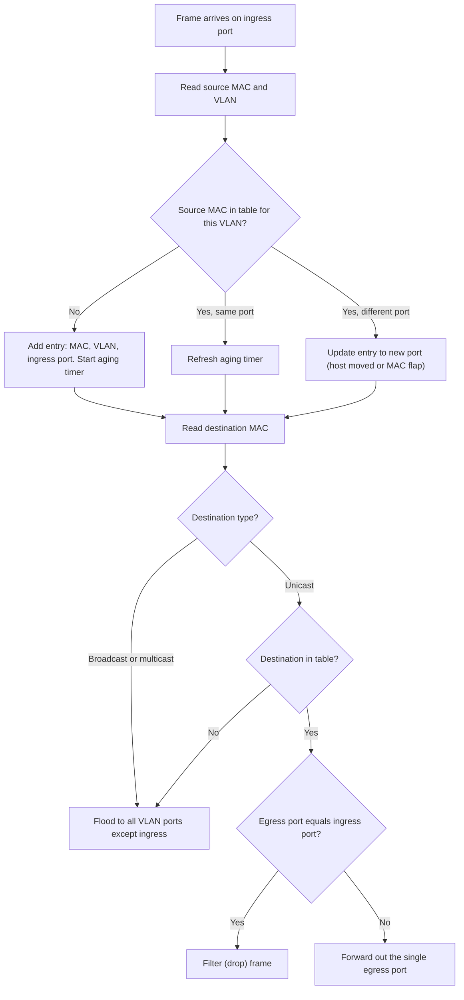
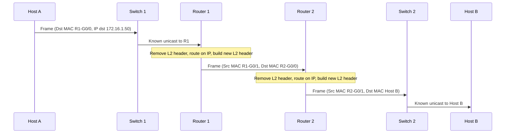
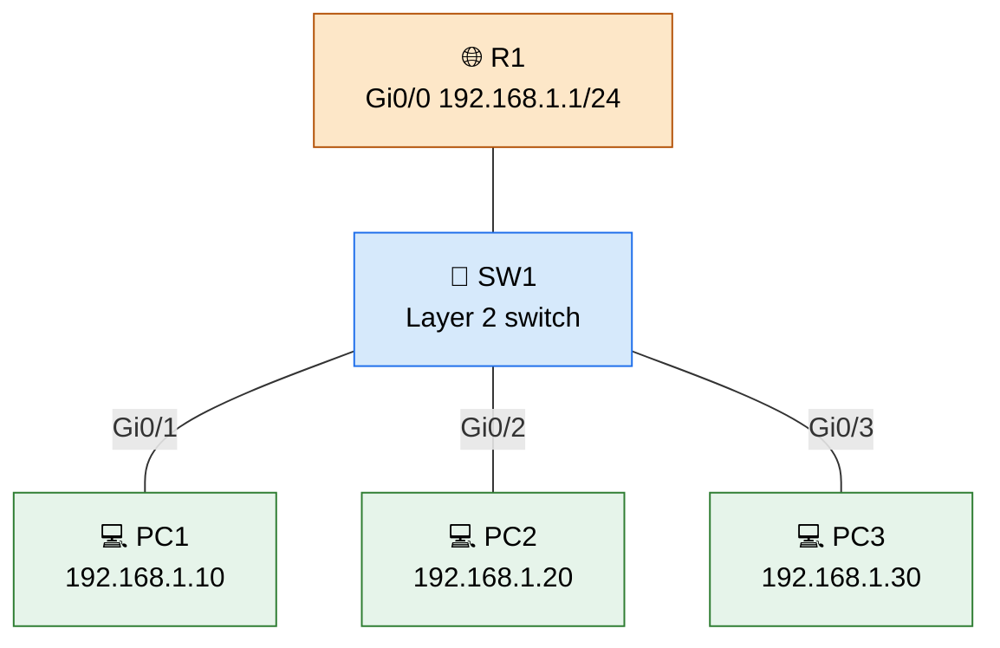
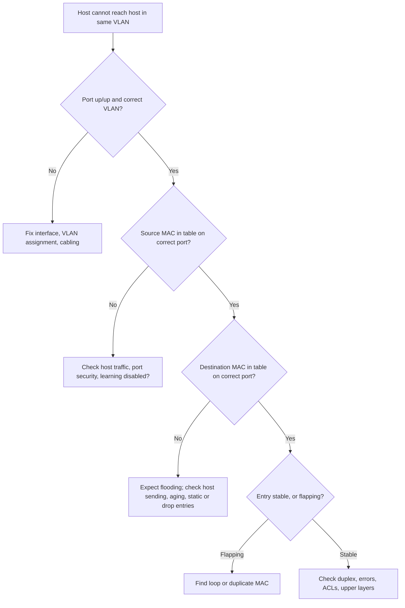

# 🔀 Layer 2 Forwarding Fundamentals and Switch Operations (CCNP ENCOR 350-401)


[](https://youtu.be/VNMyGOA_LoY)

This document explains how Ethernet switches forward frames at Layer 2: how they learn MAC addresses, how they decide between forwarding and flooding, how to manage the MAC address table on Cisco IOS/IOS-XE, and how to troubleshoot the most common Layer 2 forwarding problems.

**📖 How to read the content tags** (blockquote callouts show the icon; inline mentions show the bracketed tag)

| Tag | Meaning |
|---|---|
| 📺 **[Source]** | Concept presented in the NotebookLM material, which attributes it to the video below. I could not open the video page myself, so treat this tag as "from the provided material". |
| ➕ **[Added]** | Explanation, command, lab or example added for completeness. |
| ✏️ **[Correction]** | A statement in the provided material that was inaccurate, ambiguous or unverifiable, with the fix. |
| 🔎 **[Verify]** | Platform- or release-dependent behavior that could not be confirmed here. Check on your own device or in the Cisco documentation for your release. |

**Source video:** *CCNP ENCOR // Layer 2 Forwarding // ENCOR 350-401 Complete Course*, Jeremy's IT Lab. Link: <https://youtu.be/VNMyGOA_LoY>

## 🎯 Learning Objectives

After working through this document you should be able to:

- Compare the OSI model with the TCP/IP models and explain why engineers use a 5-layer working model.
- Define collision domain and broadcast domain, and count them in a topology.
- Explain how hubs differ from switches.
- Describe the structure of a MAC address and the four Layer 2 forwarding message types.
- Explain the learn, age, forward and flood behavior of a switch.
- Configure and verify MAC aging, static MAC entries, drop entries and learning controls.
- Recognize and mitigate MAC flooding and other forwarding faults.

## 💡 Why This Topic Matters

Almost every later ENCOR switching topic (VLANs, trunking, STP, EtherChannel, port security, first-hop redundancy) assumes you know exactly what a switch does with a frame. Many troubleshooting problems ("host reachable from one switch but not another", "traffic is being flooded", "MAC keeps moving") are Layer 2 forwarding problems.

## 📋 Prerequisites

- CCNA-level knowledge of Ethernet, IP addressing, VLAN basics and Cisco IOS navigation.
- Binary and hexadecimal conversion.

## 🚀 Where It Is Used in Enterprise Networks

> ✏️ **Correction:** The source material says Layer 2 switches operate at the access and distribution layers of a "Three-Tiered Collapsed Core" design. Those are two different designs. In a **three-tier** design there are access, distribution and core layers. In a **collapsed core** (two-tier) design the distribution and core functions are combined. Access switches are almost always Layer 2 forwarding devices; distribution/collapsed-core switches are often Layer 3 devices that also perform Layer 2 forwarding on their downlinks.

---

## 📑 Table of Contents

- [🎯 Learning Objectives](#-learning-objectives)
- [💡 Why This Topic Matters](#-why-this-topic-matters)
- [📋 Prerequisites](#-prerequisites)
- [🚀 Where It Is Used in Enterprise Networks](#-where-it-is-used-in-enterprise-networks)
- [📖 1. Introduction](#-1-introduction)
- [📚 2. Fundamentals and Prerequisites](#-2-fundamentals-and-prerequisites)
- [🧠 3. Detailed Concept Explanation](#-3-detailed-concept-explanation)
- [🌐 4. Architecture and Working Mechanism](#-4-architecture-and-working-mechanism)
- [💻 5. Cisco Configuration and CLI Commands](#-5-cisco-configuration-and-cli-commands)
- [🧪 6. Practical Lab Scenarios](#-6-practical-lab-scenarios)
- [🏢 7. Scenario-Based Learning](#-7-scenario-based-learning)
- [🔍 8. Troubleshooting and Fault Isolation](#-8-troubleshooting-and-fault-isolation)
- [📊 9. Comparison of Related Technologies](#-9-comparison-of-related-technologies)
- [🎓 10. Important CCNP Exam Points](#-10-important-ccnp-exam-points)
- [❓ 11. Knowledge Check and Practice Questions](#-11-knowledge-check-and-practice-questions)
- [📝 12. Quick Revision / Cheat Sheet](#-12-quick-revision--cheat-sheet)
- [🔗 13. References and Further Learning](#-13-references-and-further-learning)

<details>
<summary>📂 Expand detailed section index</summary>

- [🎯 Learning Objectives](#-learning-objectives)
- [💡 Why This Topic Matters](#-why-this-topic-matters)
- [📋 Prerequisites](#-prerequisites)
- [🚀 Where It Is Used in Enterprise Networks](#-where-it-is-used-in-enterprise-networks)
- [📖 1. Introduction](#-1-introduction)
- [📚 2. Fundamentals and Prerequisites](#-2-fundamentals-and-prerequisites)
  - [2.1 OSI and TCP/IP Reference Models](#21-osi-and-tcpip-reference-models)
  - [2.2 Terminology Used in This Document](#22-terminology-used-in-this-document)
- [🧠 3. Detailed Concept Explanation](#-3-detailed-concept-explanation)
  - [3.1 Legacy Shared Media and Collision Domains](#31-legacy-shared-media-and-collision-domains)
  - [3.2 Hubs versus Switches](#32-hubs-versus-switches)
  - [3.3 Broadcast Domains](#33-broadcast-domains)
  - [3.4 MAC Address Structure](#34-mac-address-structure)
  - [3.5 Ethernet Frame Structure](#35-ethernet-frame-structure)
  - [3.6 The Four Layer 2 Forwarding Message Types](#36-the-four-layer-2-forwarding-message-types)
  - [3.7 Dynamic MAC Address Learning and Aging](#37-dynamic-mac-address-learning-and-aging)
  - [3.8 Multi-Hop Encapsulation and Decapsulation](#38-multi-hop-encapsulation-and-decapsulation)
- [🌐 4. Architecture and Working Mechanism](#-4-architecture-and-working-mechanism)
  - [4.1 Switch Forwarding Decision](#41-switch-forwarding-decision)
  - [4.2 Multi-Hop Packet Flow](#42-multi-hop-packet-flow)
  - [4.3 Control Plane Versus Data Plane in a Switch](#43-control-plane-versus-data-plane-in-a-switch)
  - [4.4 Failure and Recovery Behavior](#44-failure-and-recovery-behavior)
- [💻 5. Cisco Configuration and CLI Commands](#-5-cisco-configuration-and-cli-commands)
  - [5.1 Viewing the MAC Address Table](#51-viewing-the-mac-address-table)
  - [5.2 Monitoring Table Capacity](#52-monitoring-table-capacity)
  - [5.3 Changing the Dynamic Aging Time](#53-changing-the-dynamic-aging-time)
  - [5.4 Disabling Dynamic MAC Learning for a VLAN](#54-disabling-dynamic-mac-learning-for-a-vlan)
  - [5.5 Static MAC Addresses and Drop Entries](#55-static-mac-addresses-and-drop-entries)
  - [5.6 Clearing Dynamic Entries](#56-clearing-dynamic-entries)
  - [5.7 Port Security (Added Mitigation)](#57-port-security-added-mitigation)
- [🧪 6. Practical Lab Scenarios](#-6-practical-lab-scenarios)
- [🏢 7. Scenario-Based Learning](#-7-scenario-based-learning)
- [🔍 8. Troubleshooting and Fault Isolation](#-8-troubleshooting-and-fault-isolation)
  - [8.0 Systematic Approach](#80-systematic-approach)
  - [8.1 Problem 1: Excessive Unicast Flooding](#81-problem-1-excessive-unicast-flooding)
  - [8.2 Problem 2: MAC Flapping (Duplicate MAC Address)](#82-problem-2-mac-flapping-duplicate-mac-address)
  - [8.3 Problem 3: Management Lockout from a Drop Entry](#83-problem-3-management-lockout-from-a-drop-entry)
  - [8.4 Problem 4: Duplex Mismatch](#84-problem-4-duplex-mismatch)
  - [8.5 Problem 5: MAC Table Exhaustion (MAC Flooding Attack)](#85-problem-5-mac-table-exhaustion-mac-flooding-attack)
- [📊 9. Comparison of Related Technologies](#-9-comparison-of-related-technologies)
  - [9.1 Hub vs Switch](#91-hub-vs-switch)
  - [9.2 Layer 2 Message Types](#92-layer-2-message-types)
  - [9.3 Collision Domain vs Broadcast Domain](#93-collision-domain-vs-broadcast-domain)
  - [9.4 Dynamic vs Static vs Drop Entries](#94-dynamic-vs-static-vs-drop-entries)
- [🎓 10. Important CCNP Exam Points](#-10-important-ccnp-exam-points)
  - [10.1 Facts and Defaults](#101-facts-and-defaults)
  - [10.2 Frequently Confused Concepts](#102-frequently-confused-concepts)
  - [10.3 Exam Traps](#103-exam-traps)
- [❓ 11. Knowledge Check and Practice Questions](#-11-knowledge-check-and-practice-questions)
  - [11.1 Basic Conceptual Questions](#111-basic-conceptual-questions)
  - [11.2 Intermediate Questions](#112-intermediate-questions)
  - [11.3 Advanced Scenario-Based Questions](#113-advanced-scenario-based-questions)
  - [11.4 Configuration and CLI Questions](#114-configuration-and-cli-questions)
  - [11.5 Questions from the Source Material (with Corrections)](#115-questions-from-the-source-material-with-corrections)
- [📝 12. Quick Revision / Cheat Sheet](#-12-quick-revision--cheat-sheet)
  - [12.1 Key Concepts at a Glance](#121-key-concepts-at-a-glance)
  - [12.2 Verification and Maintenance Commands](#122-verification-and-maintenance-commands)
  - [12.3 Configuration Command Reference](#123-configuration-command-reference)
  - [12.4 Critical Differences](#124-critical-differences)
  - [12.5 Troubleshooting Reminders](#125-troubleshooting-reminders)
  - [12.6 Final Revision Checklist](#126-final-revision-checklist)
- [🔗 13. References and Further Learning](#-13-references-and-further-learning)

</details>

---

## 📖 1. Introduction

**Layer 2 forwarding** is the process by which a switch receives an Ethernet frame on one port and decides which port or ports to send it out of, using only information in the Layer 2 header.

A switch makes this decision with two simple rules:

1. **Learn** from the **source MAC address** of every incoming frame.
2. **Forward** based on the **destination MAC address**.

Everything else in this document (flooding, aging, static entries, port security) is a variation or refinement of those two rules.

> 🔑 **Remember:** A switch **learns** from the **source** MAC and **forwards** on the **destination** MAC.

**[Source]** The video builds on CCNA material but stresses an exact understanding of switch behavior, because CCNP-level topics depend on it.

**Purpose of Layer 2 switching in an enterprise**

- Deliver frames at high speed between hosts in the same VLAN/subnet using MAC addresses.
- Give each device a dedicated, full-duplex link, which removes collisions.
- Apply control at the port level (MAC limits, filtering, security).
- Hand traffic that must leave the subnet to a default gateway (router or Layer 3 switch).

> 🚀 **Real-World Application:** Access-layer switches in a campus network run this learn-and-forward process for every wired endpoint and pass off-subnet traffic to the default gateway.

---

## 📚 2. Fundamentals and Prerequisites

### 2.1 OSI and TCP/IP Reference Models

The **Open Systems Interconnection (OSI)** model, published by the International Organization for Standardization (ISO), divides networking into seven layers.

| Layer | Name | Role | Examples |
|---|---|---|---|
| 7 | Application | Interface between network and application software | HTTP, FTP, SSH, DNS |
| 6 | Presentation | Data formatting, encoding, encryption, compression | TLS (commonly placed here), JPEG, ASCII |
| 5 | Session | Establish, maintain and end dialogs between applications | Session control functions |
| 4 | Transport | End-to-end delivery, segmentation, reliability, flow control | TCP, UDP |
| 3 | Network | Logical addressing and routing between networks | IPv4, IPv6, ICMP |
| 2 | Data Link | Node-to-node delivery on a local segment, framing, MAC addressing | Ethernet (IEEE 802.3), Wi-Fi (IEEE 802.11), PPP, HDLC |
| 1 | Physical | Transmission of raw bits over a medium | UTP, fiber, radio |

Real networks run the **TCP/IP** suite rather than the OSI protocol stack.

- **RFC 1122 model (4 layers):** Application (OSI 5-7), Transport, Internet, Link (OSI 1-2).
- **Engineers' working model (5 layers):** Application, Transport, Network, Data Link, Physical. The Link layer is split back into Layers 2 and 1. Engineers often write Layer 7 in brackets, `[Application]`, to mean "everything above Layer 4".

**[Source]** The video advises against arguing about whether ARP is "really" Layer 2 or Layer 3, or whether ICMP is Layer 3 or Layer 4. Protocols often straddle layer boundaries. Understanding what a protocol does matters more than the label.

> ➕ **Added:** The models help you reason about where a device operates. A switch makes forwarding decisions with the Layer 2 header. A router makes them with the Layer 3 header. A Layer 3 switch does both.

### 2.2 Terminology Used in This Document

| Term | Meaning |
|---|---|
| **MAC address** | 48-bit Layer 2 hardware address, written as 12 hexadecimal digits |
| **Frame** | Layer 2 protocol data unit (header + payload + trailer) |
| **CAM (Content Addressable Memory)** | Hardware memory used to look up MAC address table entries quickly |
| **Ingress / egress port** | Port a frame arrives on / port it leaves from |
| **Flooding** | Sending a frame out of all ports in the VLAN except the ingress port |
| **Aging** | Removing dynamic MAC entries that have not been refreshed |
| **VLAN** | Virtual LAN, a logical Layer 2 broadcast domain |

---

## 🧠 3. Detailed Concept Explanation

### 3.1 Legacy Shared Media and Collision Domains

#### Definition

Early Ethernet (**10BASE-5 "Thicknet"** and **10BASE-2 "Thinnet"**) used coaxial cable as a shared bus. Every host was attached to the same conductor, so a signal sent by one host reached all hosts.

- **Thicknet (10BASE-5):** thick, rigid coax; hosts attached through taps (often called vampire taps).
- **Thinnet (10BASE-2):** thinner, flexible coax; hosts attached with BNC T-connectors.

#### Why collisions happen

If two stations transmit at the same time on a shared medium, their signals overlap and both frames are corrupted. That event is a **collision**.

A **collision domain** is any segment on which simultaneous transmissions can collide.

#### CSMA/CD step by step

Half-duplex Ethernet manages collisions with **Carrier Sense Multiple Access with Collision Detection (CSMA/CD)**:

1. **Carrier sense:** listen to see whether the medium is idle.
2. **Multiple access:** any station may transmit when the medium is idle.
3. **Collision detection:** while sending, watch for a collision.
4. **Jam and backoff:** on a collision, send a jam signal so all stations notice, stop, wait a random backoff time (truncated binary exponential backoff), then retry.

#### Advantages and limitations

- Advantage: simple, cheap shared medium.
- Limitation: only one station can send at a time (half-duplex); throughput falls as more hosts join; collisions waste bandwidth.

#### Real-world relevance

You will not meet coax in an enterprise today, but you will meet the **concept**: a half-duplex port or a hub still creates a collision domain, and a duplex mismatch produces collision-like symptoms (see [Section 8.4](#84-problem-4-duplex-mismatch)).

### 3.2 Hubs versus Switches

#### Hub (Layer 1 multiport repeater)

- Repeats an incoming electrical signal out of every other port.
- Cannot read MAC addresses and has no frame buffers.
- All ports are in **one collision domain**, so devices must use half-duplex and CSMA/CD.

#### Switch (Layer 2 device)

- Reads the Ethernet header, learns source MACs and forwards on destination MACs.
- Buffers frames in memory when an egress port is busy.
- Provides **microsegmentation**: each port is its own collision domain.
- A port operating in full-duplex mode can send and receive at the same time, so CSMA/CD is not used on that link.

> ✏️ **Correction:** The source material states that switch ports "do not permit collisions". That is true for full-duplex ports. A switch port connected to a hub, or one that has negotiated half-duplex, still runs CSMA/CD for that segment. This is why the hub-based quiz question (Section 11.5) counts the hub segment as one shared collision domain.

### 3.3 Broadcast Domains

#### Definition

A **broadcast domain** is the set of devices that receive a Layer 2 broadcast frame (destination `ffff.ffff.ffff`) sent by any member.

#### Boundaries

- A switch floods broadcasts out of all ports **in the same VLAN**. One unsegmented switch (a single VLAN) is one broadcast domain.
- **VLANs** split one physical switch into several broadcast domains.
- A **router** does not forward Layer 2 broadcasts between interfaces. Each router interface normally terminates a broadcast domain.

#### Technical considerations

- Large broadcast domains waste bandwidth and CPU time on every host.
- Two router interfaces connected to the **same VLAN** on the same switch are in **one** broadcast domain, not two.

> 💡 **Concept:** A switch port separates collision domains. Only a router (or a VLAN boundary) separates broadcast domains.

### 3.4 MAC Address Structure

#### Definition

A **MAC address** is a 48-bit (6-byte) identifier. It is usually burned into a NIC and written as 12 hex digits.

| Portion | Size | Meaning |
|---|---|---|
| **OUI (Organizationally Unique Identifier)** | First 24 bits (6 hex digits) | Assigned by the IEEE to a vendor |
| **NIC-specific part** | Last 24 bits (6 hex digits) | Assigned by the vendor to the interface |

> 🔎 **Verify:** The source material gives `0C:F5:A4` as an example OUI registered to Cisco. That could not be confirmed here. Look up any OUI in the IEEE public OUI registry before relying on it.

> ➕ **Added:** Two bits in the first byte have special meaning. The least significant bit of the first byte is the **I/G bit** (0 = individual/unicast, 1 = group, which covers multicast and broadcast). The next bit is the **U/L bit** (0 = universally administered, 1 = locally administered). Virtual machines and some software often use locally administered addresses.

#### Notation

| Style | Example |
|---|---|
| Cisco IOS (dotted, 3 groups of 4) | `0cf5.a41a.2b3c` |
| Hyphenated (IEEE/Windows) | `0C-F5-A4-1A-2B-3C` |
| Colon separated | `0c:f5:a4:1a:2b:3c` |

(The values above are format examples only.)

### 3.5 Ethernet Frame Structure

> ➕ **Added:** The source material refers to frame structure but does not list the fields. A summary of the standard Ethernet II frame:

| Field | Size | Purpose |
|---|---|---|
| Preamble + SFD | 8 bytes | Synchronization; usually not shown by capture tools |
| Destination MAC | 6 bytes | **Used by the switch to forward** |
| Source MAC | 6 bytes | **Used by the switch to learn** |
| EtherType (or Length) | 2 bytes | Identifies the payload protocol (for example IPv4 or ARP) |
| Payload | 46 to 1500 bytes | The data; padded if shorter than 46 bytes |
| FCS (Frame Check Sequence) | 4 bytes | CRC used to detect corruption |

An 802.1Q VLAN tag (4 bytes) is inserted between the source MAC and EtherType on trunk links.

### 3.6 The Four Layer 2 Forwarding Message Types

A switch classifies each frame by its destination MAC address and the contents of its MAC address table.

| Type | Destination MAC | Switch action |
|---|---|---|
| **Known unicast** | One host MAC found in the table | Forward out the single associated port |
| **Unknown unicast** | One host MAC not in the table | Flood out all ports in the VLAN except ingress |
| **Broadcast** | `ffff.ffff.ffff` | Flood out all ports in the VLAN except ingress |
| **Multicast** | Group MAC (for example IPv4 multicast `0100.5exx.xxxx`, Cisco protocols `0100.0cxx.xxxx`) | Flood by default; limited if IGMP snooping or other controls apply |

> ➕ **Added:** Two refinements. First, if the destination is known but is learned on the **same port** the frame arrived on, the switch filters (drops) the frame instead of sending it back. Second, IGMP snooping (outside the scope of this video) lets a switch send IP multicast only to interested ports.

### 3.7 Dynamic MAC Address Learning and Aging

#### Definition and purpose

The switch builds its **MAC address table** automatically. This avoids manual configuration and lets the switch forward efficiently.

#### How it works

1. A frame arrives on a port.
2. The switch reads the **source MAC** and the VLAN.
3. If the (MAC, VLAN) pair is new, the switch adds it with the ingress port and starts the aging timer.
4. If it already exists on the same port, the switch refreshes the aging timer.
5. The switch then looks up the **destination MAC** to decide forward or flood.

#### Aging

- Default aging time for dynamic entries is **300 seconds**.
- If no frame with that source MAC is seen within that time, the entry is removed.
- Static entries do not age.

#### Advantages and limitations

- Advantage: zero-touch, self-adjusting as hosts move.
- Limitations: the table has finite capacity; an attacker or a fault can fill it (see Section 8.5); entries for silent hosts age out, which causes unknown unicast flooding until the host transmits again.

> ➕ **Added:** The table is per VLAN. The same MAC address can appear in more than one VLAN as separate entries.

### 3.8 Multi-Hop Encapsulation and Decapsulation

When Host A talks to Host B across routers:

- The **IP packet** (source and destination IP) stays the same end to end (ignoring NAT).
- The **Ethernet frame** is rebuilt at every Layer 3 hop. Source and destination MACs change at each router.

This is why a switch never sees the final destination host's MAC address for off-subnet traffic. It sees the MAC of the **next hop** (typically the default gateway).

---

## 🌐 4. Architecture and Working Mechanism

### 4.1 Switch Forwarding Decision



### 4.2 Multi-Hop Packet Flow

Scenario: Host A `192.168.1.10` requests a web page from Host B `172.16.1.50` through two routers.



Step by step:

1. **Host A** sees that Host B is on another subnet, so it frames the IP packet toward its **default gateway**. It uses ARP to find the gateway MAC if needed.
2. **Switch 1** learns Host A's MAC on the ingress port and forwards the frame to Router 1 (flooding it if Router 1's MAC is not yet known).
3. **Router 1** accepts the frame because the destination MAC is its own, strips the L2 header, looks up the destination IP, ARPs for the next hop if needed, and builds a new frame.
4. **Router 2** repeats the same process. Host B is directly connected, so the new frame is addressed to Host B's MAC.
5. **Host B** accepts the frame, removes the L2 header, and passes the packet up the stack.

### 4.3 Control Plane Versus Data Plane in a Switch

> ➕ **Added:** Normal frames between hosts are forwarded in hardware (the data plane) using CAM/ASIC lookups. Frames for control protocols (CDP, STP, VTP, DTP, LLDP and so on) are sent to the switch CPU (the control plane). That is why a Catalyst MAC table lists certain well-known addresses as static entries pointing at the CPU.

### 4.4 Failure and Recovery Behavior

| Event | Switch behavior |
|---|---|
| Host stops sending | Entry ages out after the aging time; frames to it are flooded afterward |
| Host moves to another port | First frame from the new port updates the entry; some platforms log a MAC move |
| Table full | New MACs cannot be learned; frames to unknown destinations are flooded |
| Link goes down | Platform behavior varies; dynamic entries on that port are typically flushed. **[Verify]** on your platform |
| Topology change (STP) | Aging may be shortened temporarily so stale entries clear faster (outside scope of this video) |

---

## 💻 5. Cisco Configuration and CLI Commands

All examples use Cisco IOS/IOS-XE syntax. Platform support for individual options differs; items marked **[Verify]** should be tested on your platform.

### 5.1 Viewing the MAC Address Table

#### Command

```cisco
show mac address-table
```

**Mode:** Privileged EXEC.

**Purpose:** Display every entry the switch holds: static entries (including control-plane addresses) and dynamic entries.

**Command breakdown:** The output columns are the VLAN, the MAC address, the entry **Type** (`STATIC` or `DYNAMIC`) and the **Ports** it is associated with.

**Working:** The command reads the hardware/software MAC table for display only. It changes nothing.

#### ✅ Verification and Expected Result

After hosts send traffic you should see `DYNAMIC` entries for each active host on the port it is connected to. Entries for protocols such as CDP/VTP/DTP (`0100.0ccc.cccc`), STP (`0180.c200.0000`) and broadcast (`ffff.ffff.ffff`) appear as `STATIC` pointing to `CPU`.

#### 🔍 Troubleshooting

If a host's MAC is missing, the host has not sent a frame recently, the port or VLAN is wrong, or learning is disabled for that VLAN.

> ✏️ **Correction:** The source material shows complete sample output. Table layout and the exact set of default entries differ between platforms and releases, so the sample output is not reproduced here. Run the command on your own device to see your platform's output.

<details>
<summary>💻 Related display commands</summary>

```cisco
show mac address-table dynamic
show mac address-table static
show mac address-table address 0050.56aa.bbcc
show mac address-table interface GigabitEthernet0/1
show mac address-table vlan 10
show mac address-table count
show mac address-table aging-time
```

| Command | Shows |
|---|---|
| `... dynamic` | Only learned entries |
| `... static` | Only manually configured and system entries |
| `... address <mac>` | Entry for one MAC |
| `... interface <int>` | Entries learned on one port |
| `... vlan <id>` | Entries in one VLAN |
| `... count` | Number of entries and remaining table space |
| `... aging-time` | Configured aging time |

</details>

> 🔎 **Verify:** The exact keywords available on `show mac address-table` (and whether `aging-time` and `learning` sub-commands exist) differ by platform and release.

### 5.2 Monitoring Table Capacity

```cisco
show mac address-table count
```

**Mode:** Privileged EXEC.

**Purpose:** See how many dynamic and static addresses exist and how much space remains.

**Expected result:** Counts of dynamic, static and total addresses, and the number still available.

> 🔎 **Verify:** The source material mentions about 8,192 entries for "Catalyst 2960-class" switches. Table size is hardware-dependent. Use this command or the platform datasheet for the real figure.

### 5.3 Changing the Dynamic Aging Time

#### Command

```cisco
configure terminal
 mac address-table aging-time 600
```

**Mode:** Global configuration.

**Purpose:** Change how long an inactive dynamic entry stays in the table.

<details>
<summary>🔍 Command breakdown</summary>

| Part | Meaning |
|---|---|
| `mac address-table aging-time` | Sets the dynamic aging timer |
| `600` | Seconds. Default 300. Source material gives range 10 to 1,000,000 seconds |
| `0` | Disables aging so dynamic entries stay until cleared **[Verify]** range and the meaning of 0 on your platform |

</details>

**Per-VLAN form**

```cisco
 mac address-table aging-time 60 vlan 10
```

**Working:** Entries are removed after the timer expires without a new frame from that source MAC. The timer restarts every time the switch sees a frame from that MAC on the same port.

#### ✅ Verification

```cisco
show mac address-table aging-time
```

**Expected result:** The configured value (or default 300 seconds) is displayed.

#### 🔍 Troubleshooting

If hosts that are quiet for long periods cause unicast flooding, aging may be too short. If stale entries linger after hosts move, aging may be too long or disabled.

#### 🧹 Removal / Rollback

```cisco
 no mac address-table aging-time
```

> 🎯 **Exam Tip:** Do not confuse the two forms. `no mac address-table aging-time` **restores the default (300 seconds)**. `mac address-table aging-time 0` **disables** aging.

### 5.4 Disabling Dynamic MAC Learning for a VLAN

#### Command

```cisco
configure terminal
 no mac address-table learning vlan 10,12-14
```

**Mode:** Global configuration.

**Purpose:** Stop the switch from learning dynamic MAC addresses in the listed VLANs.

#### ✅ Verification

```cisco
show mac address-table learning
```

#### 🔁 Re-enable Learning

```cisco
 mac address-table learning vlan 10,12-14
```

> 🔎 **Verify:** Availability and syntax depend on the platform and release. The sample output in the source material is omitted for the same reason as in 5.1.

> ✏️ **Correction:** The source material presents disabling learning as a defense against MAC flooding. Without learning, the switch has no dynamic entries to forward on, so unicast traffic in that VLAN is flooded. That makes the problem worse for an ordinary access VLAN. Disabling learning is a niche tool for specific designs (for example a VLAN whose traffic is not meant to be switched at Layer 2). Cisco documentation warns about the CPU impact on VLANs that have an SVI. Use port security (Section 5.7) to defend against MAC flooding.

### 5.5 Static MAC Addresses and Drop Entries

#### Static entry

```cisco
configure terminal
 mac address-table static 0050.56aa.bbcc vlan 1 interface GigabitEthernet0/1
```

**Mode:** Global configuration.

**Purpose:** Permanently bind a MAC address in a VLAN to a specific port.

<details>
<summary>🔍 Command breakdown</summary>

| Part | Meaning |
|---|---|
| `static` | Manually configured; never ages |
| `0050.56aa.bbcc` | MAC address (Cisco dotted format) |
| `vlan 1` | VLAN the entry belongs to |
| `interface GigabitEthernet0/1` | Port to forward frames to |

</details>

**Working:** Frames to that MAC in that VLAN always go out `Gi0/1`, even if the host appears elsewhere.

#### ✅ Verification

```cisco
show mac address-table static
show mac address-table address 0050.56aa.bbcc
```

#### 🧹 Removal / Rollback

```cisco
 no mac address-table static 0050.56aa.bbcc vlan 1 interface GigabitEthernet0/1
```

#### Drop (blackhole) entry

```cisco
 mac address-table static 0011.2233.4455 vlan 1 drop
```

**Purpose:** Instruct the switch to discard traffic for that MAC address in that VLAN.

#### 🧹 Removal / Rollback

```cisco
 no mac address-table static 0011.2233.4455 vlan 1 drop
```

> ✏️ **Correction:** The source material says the drop entry discards frames **destined to** the MAC. On Cisco Catalyst platforms the feature is described as unicast MAC address **filtering**, which drops traffic with that MAC as source **or** destination. **[Verify]** the exact behavior for your platform and release.

> ⚠️ **Warning:** The source material attributes this anecdote to the video: the presenter once entered a drop entry for his own PC's MAC address while connected to a remote switch over SSH, lost the session immediately, and had to use a console cable to remove it. Lesson: never apply drop or filter entries for the MAC address of the device you are managing from, unless you have out-of-band (console) access.

### 5.6 Clearing Dynamic Entries

**Mode:** Privileged EXEC.

```cisco
clear mac address-table dynamic
clear mac address-table dynamic address 0010.1122.3344
clear mac address-table dynamic interface GigabitEthernet0/1
clear mac address-table dynamic vlan 10
```

| Command | Effect |
|---|---|
| `clear mac address-table dynamic` | Removes all dynamic entries |
| `... address <mac>` | Removes one MAC |
| `... interface <int>` | Removes entries learned on one port |
| `... vlan <id>` | Removes entries in one VLAN |

**Working:** The switch immediately forgets the entries. Frames to those hosts are flooded until the hosts transmit again and are re-learned.

**Troubleshooting use:** Clear a single entry after moving a host or replacing a NIC to confirm that the switch relearns the correct port.

> ⚠️ **Warning:** Clearing all dynamic entries on a busy production switch causes a burst of unknown unicast flooding.

### 5.7 Port Security (Added Mitigation)

> ➕ **Added:** The source material mentions port security only in the troubleshooting section. This summary is added because it is the standard control against MAC flooding.

```cisco
configure terminal
 interface GigabitEthernet0/1
  switchport mode access
  switchport port-security
  switchport port-security maximum 2
  switchport port-security violation restrict
  switchport port-security mac-address sticky
```

| Command | Purpose |
|---|---|
| `switchport mode access` | Port security needs a statically configured access (or trunk) port |
| `switchport port-security` | Enable port security on the port |
| `maximum 2` | Allow at most two secure MAC addresses (default is 1) |
| `violation restrict` | On violation, drop offending frames and log, but keep the port up. Alternatives are `protect` (drop silently) and `shutdown` (err-disable; default) |
| `mac-address sticky` | Learn MACs dynamically and keep them in the running configuration |

#### ✅ Verification

```cisco
show port-security
show port-security interface GigabitEthernet0/1
show port-security address
```

**Expected result:** The interface shows port security enabled, the maximum and current secure address counts, the violation mode, and violation counters.

#### 🔍 Troubleshooting

If a port is `err-disabled` after a violation, fix the cause, then `shutdown` and `no shutdown` the interface, or use `errdisable recovery cause psecure-violation` for automatic recovery.

#### 🧹 Removal / Rollback

```cisco
 no switchport port-security
```

---

## 🧪 6. Practical Lab Scenarios

Labs use a simple topology. The virtual switch platforms Cisco IOSvL2 (in CML or GNS3) provide `GigabitEthernet0/0` to `GigabitEthernet0/3`, matching the source topology. Adapt interface names to your platform.

### Common Topology



> The topology puts R1 on SW1 `Gi0/0`. The MAC addresses in the source topology table (`1111.1111.1111` and so on) are examples. In a real lab, read the real MAC addresses from the devices (for example `ipconfig /all` on a host or `show interfaces` on a router).

**IP Addressing Table (all in VLAN 1)**

| Device | Interface | IP Address | Subnet Mask | Default Gateway | Connected to |
|---|---|---|---|---|---|
| R1 | Gi0/0 | 192.168.1.1 | 255.255.255.0 | n/a | SW1 Gi0/0 |
| SW1 | Vlan1 (management) | 192.168.1.2 | 255.255.255.0 | 192.168.1.1 | n/a |
| PC1 | NIC | 192.168.1.10 | 255.255.255.0 | 192.168.1.1 | SW1 Gi0/1 |
| PC2 | NIC | 192.168.1.20 | 255.255.255.0 | 192.168.1.1 | SW1 Gi0/2 |
| PC3 | NIC | 192.168.1.30 | 255.255.255.0 | 192.168.1.1 | SW1 Gi0/3 |

**Base configuration**

R1:

```cisco
hostname R1
interface GigabitEthernet0/0
 description To SW1 Gi0/0
 ip address 192.168.1.1 255.255.255.0
 no shutdown
```

SW1:

```cisco
hostname SW1
interface range GigabitEthernet0/0 - 3
 switchport mode access
 switchport access vlan 1
 no shutdown
interface Vlan1
 ip address 192.168.1.2 255.255.255.0
 no shutdown
ip default-gateway 192.168.1.1
```

### 🧪 Lab 1: Observe Learning, Flooding and Forwarding

**Objective:** Watch the switch learn MAC addresses and move from flooding to selective forwarding.

**Topology:** Common topology above.

**Requirements:**

- Start with an empty dynamic MAC table.
- Observe which entries appear after each action.
- Confirm which frames are flooded.

**Configuration:** Base configuration only.

**Steps and explanation:**

1. Clear the table:

   ```cisco
   clear mac address-table dynamic
   show mac address-table dynamic
   ```

   Expected: no dynamic entries (static control entries may remain).

2. Ping from R1 to PC1:

   ```cisco
   R1# ping 192.168.1.10
   ```

   Expected: R1 sends an ARP request (a **broadcast**), so SW1 learns R1's MAC on `Gi0/0` and floods the request. PC1's ARP reply is unicast to R1, so SW1 learns PC1 on `Gi0/1`.

   > **[Correction]** The source walkthrough shows R1 sending a unicast frame to PC1 that SW1 must flood. That only happens if R1 already has PC1 in its ARP cache while SW1's table is empty (for example after you clear only the switch table). On a freshly booted network, ARP broadcasts come first. To reproduce the unknown unicast case exactly, ping once, then run `clear mac address-table dynamic` on SW1 (not `clear arp` on R1), and ping again.

3. Verify:

   ```cisco
   SW1# show mac address-table dynamic
   ```

   Expected: R1's MAC on `Gi0/0` and PC1's MAC on `Gi0/1`.

4. Ping PC2 and PC3 from R1 and check the table again.

**Testing:** While PC2 captures traffic (Wireshark in GNS3/CML, or Packet Tracer simulation mode), confirm that PC2 sees the flooded unknown unicast frame but not later PC1-to-R1 known unicast frames.

**Expected outcome:** Each host appears in the table on the port it is connected to. Later frames between R1 and PC1 are not seen by PC2 or PC3.

### 🧪 Lab 2: Aging Timer and Static Entries

**Objective:** Change aging and pin a MAC address to a port.

**Configuration (SW1):**

```cisco
configure terminal
 mac address-table aging-time 60
 mac address-table static 3333.3333.3333 vlan 1 interface GigabitEthernet0/3
```

(Replace `3333.3333.3333` with PC3's real MAC.)

**Explanation:** The first command shortens aging so entries disappear after about a minute of inactivity. The second adds a static entry for PC3 that never ages.

#### ✅ Verification

```cisco
show mac address-table aging-time
show mac address-table static
show mac address-table dynamic
```

**Testing:** Stop traffic for a few minutes. Dynamic entries for PC1 and PC2 should disappear. The static entry for PC3 should remain.

**Expected outcome:** Only static entries remain after the aging period. New traffic repopulates the dynamic entries.

#### 🧹 Removal / Rollback

```cisco
 no mac address-table static 3333.3333.3333 vlan 1 interface GigabitEthernet0/3
 no mac address-table aging-time
```

### 🧪 Lab 3: Limit MAC Addresses with Port Security

**Objective:** Prevent a single access port from learning an unlimited number of MAC addresses.

**Configuration (SW1):**

```cisco
interface GigabitEthernet0/1
 switchport mode access
 switchport port-security
 switchport port-security maximum 2
 switchport port-security violation restrict
 switchport port-security mac-address sticky
```

**Explanation:** Gi0/1 can now learn at most two MAC addresses. Extra source MACs trigger the violation action.

#### ✅ Verification

```cisco
show port-security interface GigabitEthernet0/1
show port-security address
show mac address-table interface GigabitEthernet0/1
```

**Testing:** Connect a third device, or a small switch with two extra hosts, to `Gi0/1` and send traffic. Watch the violation counter increase.

**Expected outcome:** The first two MAC addresses are secured. Traffic from further MACs is dropped and logged, and the port stays up because the mode is `restrict`.

---

## 🏢 7. Scenario-Based Learning

### 🏢 Scenario 1: Silent Server Causes Unicast Flooding

- **Business requirement:** A file server must be reachable with minimal impact on other users.
- **Existing condition:** Aging time is the default 300 seconds. The server answers requests but sends very little unsolicited traffic.
- **Problem:** Users complain of slow performance, and a packet capture on a workstation shows frames addressed to the server arriving on every port.
- **Technical analysis:** Clients send frames to the server. If the server's MAC has aged out because it has not **sent** a frame in 300 seconds, the switch floods the unknown unicast. The next frame from the server re-learns it.
- **Recommended solution:** Investigate why the server is silent (asymmetric routing is a common cause, where the server's replies leave through a different switch). If appropriate, tune aging for the affected VLAN.
- **Configuration:**

  ```cisco
  mac address-table aging-time 1800 vlan 20
  ```

- **Verification:** `show mac address-table aging-time` and recheck the capture.
- **Final outcome:** Entries persist longer and flooding drops. Fixing asymmetric routing remains the real cure.

### 🏢 Scenario 2: Branch Switch Reports a MAC Moving Between Ports

- **Business requirement:** Stable connectivity for a branch office.
- **Existing condition:** Users report intermittent connectivity. SW1 logs messages that a host is flapping between two ports.
- **Problem:** The same MAC is being seen on two ports.
- **Technical analysis:** Common causes are a Layer 2 loop, two NICs bonded without proper aggregation, or a duplicated MAC address.
- **Recommended solution:** Use `show mac address-table address <mac>` repeatedly, trace both ports, and remove the loop or duplicate. See [Section 8.2](#82-problem-2-mac-flapping-duplicate-mac-address).
- **Verification:** The entry stays on one port; log messages stop.
- **Final outcome:** Stable forwarding.

### 🏢 Scenario 3: MAC Flooding Attack in a Guest Area

- **Business requirement:** Guest ports must not expose other users' traffic.
- **Problem:** An attacker generates thousands of fake source MACs.
- **Technical analysis:** The CAM table fills; the switch can no longer learn new addresses and floods unknown unicast, so an attacker may see traffic that was not meant for them.
- **Recommended solution:** Port security with a low maximum.
- **Configuration:** See Section 5.7.
- **Verification:** `show port-security interface <int>` shows violations; `show mac address-table count` stays well below capacity.
- **Final outcome:** The attacker's port is limited to its permitted addresses.

---

## 🔍 8. Troubleshooting and Fault Isolation

### 8.0 Systematic Approach



Rule of thumb: confirm **physical and VLAN**, then **source MAC learned**, then **destination MAC known**, then **stability**, then upper layers.

### 8.1 Problem 1: Excessive Unicast Flooding

1. **Description:** Frames for single hosts appear on many ports.
2. **Symptoms:** Slow links, unexpected traffic in captures, high utilization on access ports.

<details>
<summary>🔍 Click to expand causes, diagnostics, procedure and fix</summary>

3. **Possible root causes:** Aging too short, silent hosts, asymmetric routing, table full, learning disabled in the VLAN, recent `clear mac address-table dynamic`.
4. **Diagnostic commands:**

   ```cisco
   show mac address-table count
   show mac address-table aging-time
   show mac address-table learning
   show mac address-table address <mac>
   ```

5. **Interpretation:** No entry for the destination means flooding is expected. A full table means the table is exhausted. Learning disabled means no dynamic entries will appear.
6. **Procedure:** Check whether the destination MAC exists; check whether the host sends traffic; check table usage; check for learning controls on the VLAN.
7. **Corrective configuration:** Re-enable learning or adjust aging as appropriate (Sections 5.3 and 5.4); apply port security if the cause is an attack.
8. **Verification:** The destination MAC appears on the correct port and captures show selective forwarding.

</details>

### 8.2 Problem 2: MAC Flapping (Duplicate MAC Address)

1. **Description:** The switch sees one source MAC alternately on different ports.
2. **Symptoms:** Intermittent loss, log messages about a host flapping between ports (exact text varies by platform).

<details>
<summary>🔍 Click to expand causes, diagnostics, procedure and fix</summary>

3. **Possible root causes:** Layer 2 loop, duplicate MAC from cloned VMs or NICs, misconfigured NIC teaming.
4. **Diagnostic commands:**

   ```cisco
   show mac address-table address <mac>
   show logging
   show interfaces <int> counters
   ```

5. **Interpretation:** If the entry's port changes between repeated runs, the MAC is moving.
6. **Procedure:** Identify both ports, check where each leads, look for loops or duplicate devices.
7. **Corrective action:** Remove the loop (STP configuration, cabling), correct the duplicate address or teaming mode.
8. **Verification:** Repeated `show` commands show a constant port and the log messages stop.

</details>

### 8.3 Problem 3: Management Lockout from a Drop Entry

1. **Description:** A host or admin PC suddenly cannot communicate after a static drop entry was added.
2. **Symptoms:** Remote session dies when the command is entered.

<details>
<summary>🔍 Click to expand causes, diagnostics, procedure and fix</summary>

3. **Root cause:** Static drop entry for the admin station's MAC.
4. **Diagnostic commands:**

   ```cisco
   show mac address-table static
   show running-config | include mac address-table static
   ```

5. **Interpretation:** A `drop` entry for the affected MAC confirms the cause.
6. **Procedure:** Reach the switch through a console or another unaffected path.
7. **Incorrect configuration:**

   ```cisco
   mac address-table static 0050.56aa.bbcc vlan 1 drop
   ```

   **Corrected configuration:**

   ```cisco
   no mac address-table static 0050.56aa.bbcc vlan 1 drop
   ```

8. **Verification:** The entry is gone from `show mac address-table static` and the session recovers.

</details>

### 8.4 Problem 4: Duplex Mismatch

1. **Description:** One end of a link operates half-duplex while the other operates full-duplex.
2. **Symptoms:** Poor throughput, late collisions and other errors on the half-duplex side, CRC/runt errors on the full-duplex side.

<details>
<summary>🔍 Click to expand causes, diagnostics, procedure and fix</summary>

3. **Root causes:** One side hard-coded and the other left on auto-negotiation, or both hard-coded differently.
4. **Diagnostic commands:**

   ```cisco
   show interfaces status
   show interfaces GigabitEthernet0/1
   ```

5. **Interpretation:** Compare speed/duplex on both ends and look at collision and error counters.
6. **Procedure:** Check both ends of the link; align settings.
7. **Incorrect configuration:** one side `duplex full` and the other side left on auto. **Corrected:** use auto on both ends, or hard-code both ends identically.

   ```cisco
   interface GigabitEthernet0/1
    duplex auto
    speed auto
   ```

   **[Verify]** Gigabit and faster Ethernet normally rely on auto-negotiation; manual duplex settings may not be allowed on some links or optics.

8. **Verification:** Both ends report the same speed and duplex, and error counters stop climbing.

</details>

### 8.5 Problem 5: MAC Table Exhaustion (MAC Flooding Attack)

1. **Description:** An attacker generates many fake source MACs to fill the table.
2. **Symptoms:** Table count near capacity, widespread unicast flooding, possible sniffing exposure.

<details>
<summary>🔍 Click to expand causes, diagnostics, procedure and fix</summary>

3. **Root causes:** No limit on MACs per port.
4. **Diagnostic commands:**

   ```cisco
   show mac address-table count
   show mac address-table interface GigabitEthernet0/1
   ```

5. **Interpretation:** A huge number of entries on a single access port is abnormal.
6. **Procedure:** Identify the port with an abnormal entry count, isolate it, apply port security.
7. **Corrective configuration:** See Section 5.7.

   > **[Correction]** The source material suggests increasing the aging time as a mitigation. Longer aging keeps fake entries in the table longer, so it does not help. Limiting MAC addresses per port does.

8. **Verification:** Port security counters show violations being handled and the table count stays stable.

</details>

---

## 📊 9. Comparison of Related Technologies

### 9.1 Hub vs Switch

| Dimension | Hub | Switch |
|---|---|---|
| Layer | 1 | 2 |
| Intelligence | Repeats signals | Reads MAC addresses |
| Collision domains | One for all ports | One per port |
| Duplex | Half | Full (when connected to a full-duplex device) |
| Collision handling | CSMA/CD | Buffering; no collisions on full-duplex links |
| Forwarding | All ports except ingress | Selective by destination MAC, flood when unknown |
| Typical use today | Obsolete | Standard access/distribution |

### 9.2 Layer 2 Message Types

| Type | Destination | Table status | Action |
|---|---|---|---|
| Known unicast | Specific host MAC | Present | Forward to one port |
| Unknown unicast | Specific host MAC | Absent | Flood in VLAN |
| Broadcast | `ffff.ffff.ffff` | Not applicable | Flood in VLAN |
| Multicast | Group MAC | Not applicable | Flood by default; may be pruned by IGMP snooping |

### 9.3 Collision Domain vs Broadcast Domain

| | Collision domain | Broadcast domain |
|---|---|---|
| Defined by | Shared medium where transmissions collide | Set of devices that receive a Layer 2 broadcast |
| Separated by | Switch ports, bridges, routers | Routers (and VLANs) |
| Hub effect | Extends it | Extends it |
| Switch effect | Splits it per port | Does **not** split it (without VLANs) |
| Router effect | Splits it | Splits it |

### 9.4 Dynamic vs Static vs Drop Entries

| | Dynamic | Static | Static drop |
|---|---|---|---|
| Created by | Learning | Administrator | Administrator |
| Ages? | Yes | No | No |
| Survives reboot? | No | Saved in startup-config if saved | Saved in startup-config if saved |
| Use | Normal forwarding | Fixed binding of MAC to port | Block traffic for a MAC |

---

## 🎓 10. Important CCNP Exam Points

> 🎯 **Exam Tip:** For any MAC table question, first decide whether it is about learning (source MAC), forwarding (destination MAC) or aging (timer). Separating these three ideas removes most confusion.

### 10.1 Facts and Defaults

| Item | Value |
|---|---|
| Default dynamic MAC aging time | 300 seconds |
| Disable aging | `mac address-table aging-time 0` |
| Restore default aging | `no mac address-table aging-time` |
| MAC length / OUI length | 48 bits / 24 bits |
| Forward on | Destination MAC |
| Learn from | Source MAC |
| Default for multicast frames | Flood within the VLAN (unless IGMP snooping applies) |
| Port security default maximum / violation | 1 / shutdown |

> 🔎 **Verify:** Table capacity and exact aging range depend on the platform.

### 10.2 Frequently Confused Concepts

- **Learn vs forward:** source MAC learns, destination MAC forwards.
- **Unknown unicast vs broadcast:** both flood, but they are different message types.
- **Collision domain vs broadcast domain:** switches split collision domains, not broadcast domains.
- **`no ... aging-time` vs `aging-time 0`:** default vs disabled.
- **Static entries vs dynamic entries:** static never age.
- **Same-port destination:** the switch filters instead of forwarding back.

### 10.3 Exam Traps

1. A question asking which MAC field is used to forward and which to learn.
2. Two router interfaces connected to the same switch and VLAN: one broadcast domain.
3. A hub attached to a switch port: the hub and everything on it share one collision domain.
4. A drop entry is not the same as shutting a port.
5. Aging does not affect static entries.
6. Counting questions: draw the topology and mark each router interface, switch port and hub segment explicitly.

---

## ❓ 11. Knowledge Check and Practice Questions

### 11.1 Basic Conceptual Questions

1. Which MAC address field does a switch use to build its MAC address table?
2. What does a switch do with a frame whose destination MAC is not in its table?
3. What is the default dynamic MAC aging time on a Cisco switch?
4. Name the two parts of a MAC address and the size of each.
5. What type of device terminates a Layer 2 broadcast domain?

### 11.2 Intermediate Questions

6. Why does a switch port connected to a hub still experience collisions?
7. What is the difference between `no mac address-table aging-time` and `mac address-table aging-time 0`?
8. What happens to a static MAC entry when the aging timer expires?
9. A frame arrives on port Gi0/1 and its destination MAC is learned on Gi0/1 too. What does the switch do?
10. Why are some entries in the MAC table marked `CPU`?

### 11.3 Advanced Scenario-Based Questions

11. A host is reachable only intermittently, and `show mac address-table address <mac>` shows a different port every few seconds. List two likely causes and the next step for each.
12. After running `clear mac address-table dynamic` during business hours, users report brief slowness. Explain why.
13. An administrator adds a drop entry for the MAC of a server and the server's users report outages. How would you verify and fix this?
14. Server replies leave through a different switch than requests arrive on. Why can this cause flooding on the request path?
15. A guest port has no MAC limit. Describe how an attacker could use that to see other users' traffic and how you would stop it.

### 11.4 Configuration and CLI Questions

16. Write the command to set the aging time to 10 minutes.
17. Write the command to bind `0050.56aa.bbcc` in VLAN 20 to `GigabitEthernet0/5`.
18. Which command displays how many MAC entries are used?
19. Write the interface-level commands to allow at most 3 sticky-learned MACs and keep the port up on violation.
20. Which command removes all dynamic entries learned in VLAN 10?

### 11.5 Questions from the Source Material (with Corrections)

**Q-A (collision domains).** Source question: two switches connected by a point-to-point link. Switch 1 has 2 hosts directly attached and 2 hosts via a hub. Switch 2 has 2 hosts directly attached and 1 router. How many collision domains exist?

**Q-B (broadcast domains).** Source question: two routers connected by a point-to-point link; Router 1 connects to 2 switches; Router 2 connects to 2 switches. How many broadcast domains exist?

**Q-C.** Which Ethernet field does a switch use to make a forwarding decision?

**Q-D.** Which message type is NOT flooded: broadcast, multicast, unknown unicast or known unicast?

**Q-E.** Which command disables dynamic MAC aging completely?

<details>
<summary>✅ Click to reveal the answers</summary>

**Basic**

1. The **source MAC** address.
2. It **floods** the frame out of all ports in the VLAN except the ingress port.
3. **300 seconds**.
4. **OUI** (24 bits) and the **NIC-specific** part (24 bits), 48 bits in total.
5. A **router** (or a VLAN boundary on a switch).

**Intermediate**

6. The hub repeats signals to every device attached to it, so the hub and its devices share one collision domain and the switch port runs half-duplex with CSMA/CD.
7. `no ...` restores the default (300 seconds). `aging-time 0` disables aging.
8. Nothing. Static entries do not age.
9. It **filters** (drops) the frame. Sending it back out the same port is pointless.
10. They are control-plane addresses (for example CDP/VTP/DTP, STP, broadcast). Frames to them go to the switch CPU for processing.

**Advanced**

11. Likely causes: a Layer 2 loop (check STP, cabling) and a duplicate MAC or NIC teaming misconfiguration (check both ports' devices). Next step: trace each port, repeat the `show` command, check logs.
12. The switch forgets all hosts. Until each host sends a frame again, frames to them are unknown unicast and are flooded.
13. Run `show mac address-table static` to find the drop entry, then remove it with `no mac address-table static <mac> vlan <id> drop`.
14. The switch only learns a MAC from frames the host **sends**. If replies do not pass through that switch, its entry for the server ages out and request frames are flooded.
15. The attacker fills the MAC table with fake MACs; the switch floods unknown unicast, so the attacker may see other users' traffic. Mitigate with port security (a low `maximum`, `violation restrict` or `shutdown`).

**CLI**

16. `mac address-table aging-time 600`
17. `mac address-table static 0050.56aa.bbcc vlan 20 interface GigabitEthernet0/5`
18. `show mac address-table count`
19. Interface configuration:

    ```cisco
    switchport mode access
    switchport port-security
    switchport port-security maximum 3
    switchport port-security violation restrict
    switchport port-security mac-address sticky
    ```
20. `clear mac address-table dynamic vlan 10`

**Source-material questions**

- **Q-A.** The source material gives **8**, but its counting does not match the topology as described. Counting each part: Switch 1's 2 direct hosts (2), the hub segment including its 2 hosts and the switch port (1), the inter-switch link (1), Switch 2's 2 direct hosts (2), and the Switch 2 to router link (1) gives **7**. **[Verify]** against the actual diagram in the video, since the description in the notes may differ from the original.
- **Q-B.** The source material gives **7**. For the topology as described (one router-to-router link, two router interfaces toward Router 1's switches, two toward Router 2's switches), a count gives **5** (1 + 2 + 2). **[Verify]** against the video diagram; the original may have more interfaces than the text describes.
- **Q-C.** **Destination MAC address.** IP addresses are Layer 3 and are not used by a Layer 2 switch for basic forwarding.
- **Q-D.** **Known unicast.** It is forwarded out one port. Broadcast, multicast (by default) and unknown unicast are flooded.
- **Q-E.** `mac address-table aging-time 0`. `no mac address-table aging-time` restores the default instead.

</details>

---

## 📝 12. Quick Revision / Cheat Sheet

> 🔑 **Remember:** Learn on the source MAC, forward on the destination MAC. Flood when the destination is unknown, broadcast or (by default) multicast.

### 12.1 Key Concepts at a Glance

| Concept | Key point |
|---|---|
| Learning | Source MAC and VLAN build the table |
| Forwarding | Destination MAC decides; known unicast goes out one port |
| Flooding | Unknown unicast, broadcast and (by default) multicast go out all VLAN ports except ingress |
| Aging | Default 300 seconds; static entries never age |
| Same-port destination | The frame is filtered (dropped) |
| Collision domain | One per full-duplex switch port; a hub shares one across all its ports |
| Broadcast domain | Ended by a router or a VLAN boundary, not by a switch alone |
| Control entries | Well-known addresses (CDP/VTP/DTP, STP, broadcast) point to the CPU |

### 12.2 Verification and Maintenance Commands

| Command | Mode | Purpose |
|---|---|---|
| `show mac address-table` | Privileged EXEC | All entries |
| `show mac address-table dynamic` | Privileged EXEC | Learned entries only |
| `show mac address-table static` | Privileged EXEC | Static and system entries |
| `show mac address-table address <mac>` | Privileged EXEC | One MAC |
| `show mac address-table interface <int>` | Privileged EXEC | Entries on one port |
| `show mac address-table vlan <id>` | Privileged EXEC | Entries in one VLAN |
| `show mac address-table count` | Privileged EXEC | Entry counts and free space |
| `show mac address-table aging-time` | Privileged EXEC | Configured aging time |
| `show mac address-table learning` | Privileged EXEC | Learning status per VLAN (platform-dependent) |
| `show port-security interface <int>` | Privileged EXEC | Port security state and counters |
| `clear mac address-table dynamic` | Privileged EXEC | Remove dynamic entries; add `address`, `interface` or `vlan` to narrow |

### 12.3 Configuration Command Reference

| Command | Mode | Effect |
|---|---|---|
| `mac address-table aging-time <seconds>` | Global configuration | Set aging time; 0 disables aging |
| `mac address-table aging-time <seconds> vlan <id>` | Global configuration | Per-VLAN aging time |
| `no mac address-table aging-time` | Global configuration | Restore the default (300 seconds) |
| `mac address-table static <mac> vlan <id> interface <int>` | Global configuration | Pin a MAC to a port |
| `mac address-table static <mac> vlan <id> drop` | Global configuration | Drop or filter that MAC (platform-dependent) |
| `no mac address-table learning vlan <list>` | Global configuration | Disable learning in VLANs; use with care |
| `switchport port-security` | Interface configuration | Enable port security |
| `switchport port-security maximum <n>` | Interface configuration | Limit secure MACs on the port |
| `switchport port-security violation <mode>` | Interface configuration | Mode is protect, restrict or shutdown |
| `switchport port-security mac-address sticky` | Interface configuration | Keep learned secure MACs in the running configuration |

**Configuration pattern: limit MACs on an access port**

```cisco
interface GigabitEthernet0/1
 switchport mode access
 switchport port-security
 switchport port-security maximum 2
 switchport port-security violation restrict
 switchport port-security mac-address sticky
```

### 12.4 Critical Differences

| Compare | Difference |
|---|---|
| `no ... aging-time` vs `aging-time 0` | Default (300 s) vs aging disabled |
| Hub vs switch | One shared collision domain vs one per port |
| Unknown unicast vs known unicast | Flooded vs forwarded to one port |
| Static vs dynamic entry | Permanent vs learned and aged |
| Collision domain vs broadcast domain | Split by switch ports vs split by routers and VLANs |
| Learn vs forward | Source MAC vs destination MAC |

### 12.5 Troubleshooting Reminders

- Check port state and VLAN first, then source MAC, then destination MAC, then stability.
- A MAC that keeps changing ports points to a loop or a duplicate MAC.
- Never apply a drop entry for the MAC of the host you manage the switch from.
- Limit MACs per port; changing the aging time does not stop MAC flooding.
- Matching duplex on both ends removes most late-collision symptoms.

### 12.6 Final Revision Checklist

- [ ] I can state which MAC field is used for learning and which for forwarding.
- [ ] I can list the four message types and the action for each.
- [ ] I know the default aging time and the difference between `no aging-time` and `aging-time 0`.
- [ ] I can count collision and broadcast domains in a diagram.
- [ ] I can configure and verify a static entry and port security.
- [ ] I can follow the troubleshooting flowchart in Section 8.0.
---

## 🔗 13. References and Further Learning

**Source video**

- Jeremy's IT Lab, *CCNP ENCOR // Layer 2 Forwarding // ENCOR 350-401 Complete Course*: <https://youtu.be/VNMyGOA_LoY>

**Additional references (not part of the original video)**

- Cisco Catalyst / IOS XE configuration guides: the Layer 2 / Switching configuration guide for your platform and release, sections on MAC address table management and port security. Search for the exact guide title on the Cisco documentation site, because titles differ by platform.
- Cisco command references for `mac address-table` and `switchport port-security` for your platform.
- IEEE 802.3 (Ethernet) and IEEE OUI public registry.
- RFC 1122, *Requirements for Internet Hosts - Communication Layers*: <https://www.rfc-editor.org/rfc/rfc1122>
- RFC 826, *An Ethernet Address Resolution Protocol*: <https://www.rfc-editor.org/rfc/rfc826>
- RFC 1112, *Host Extensions for IP Multicasting* (includes IPv4 multicast to Ethernet MAC mapping): <https://www.rfc-editor.org/rfc/rfc1112>

**Items needing verification before publishing**

- Original quiz answers for collision and broadcast domain counting (Section 11.5).
- Exact behavior of static `drop` entries on your platform (Section 5.5).
- Availability of `show mac address-table learning` and `mac address-table learning vlan` (Section 5.4).
- MAC table capacity and the aging range for your specific platform.
- The OUI example `0C:F5:A4` quoted in the source material.
